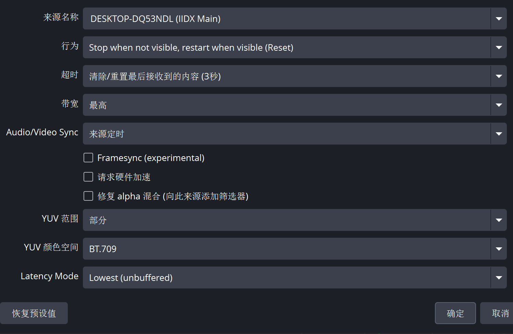
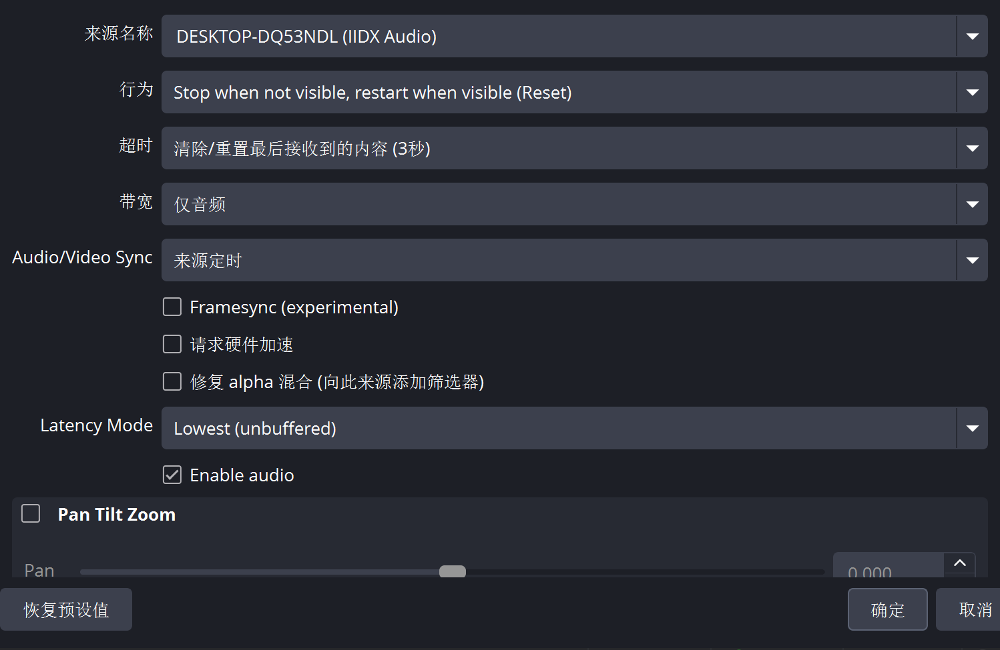

# bemandi

[English](README.md) | [简体中文](README.zh-CN.md)

Stream IIDX video and native game audio over NDI directly from a Windows x64 Spice plugin to OBS Studio on **another computer**.

## Features

- Direct D3D9/D3D9Ex game capture, tested at 1920×1080 / 120 Hz on IIDX34.
- Native stereo audio at 44.1 kHz, tested with the cabinet's ASIO output.
- Separate `IIDX Main` video and `IIDX Audio` sources with synchronized sender timecodes from a shared clock.
- GPU UYVY conversion and bounded capture queues; transmission runs on worker threads.

## Install NDI and OBS

Use two computers on the same wired network:

- **IIDX game PC:** install the **NDI 6 Runtime** and bemandi.dll. OBS is not required on this PC.
- **Another computer (streaming PC):** install **OBS Studio**, the [DistroAV NDI plugin](https://github.com/DistroAV/DistroAV), and its required **NDI Runtime**.

For OBS/DistroAV setup, follow the DistroAV wiki's [Installation → Windows](https://github.com/DistroAV/DistroAV/wiki/1.-Installation#windows) section (or the section for your streaming PC's operating system). Check the [current OBS and NDI version requirements](https://github.com/DistroAV/DistroAV#-requirements) before installing.

For NDI SDK/runtime setup and download links, see [Required Components — NDI Runtime](https://github.com/DistroAV/DistroAV/wiki/1.-Installation#required-components---ndi-runtime). On Windows, the standalone runtime is sufficient to run bemandi; the full developer SDK is not needed. Install the runtime on the IIDX game PC as well as the streaming PC.

Windows installation commands:

```powershell
# IIDX game PC: install the NDI runtime.
winget install --exact --id NDI.NDIRuntime

# Run on ANOTHER computer: install DistroAV, OBS, and their dependencies.
winget install --exact --id DistroAV.DistroAV
```

If using manual installers instead, install OBS, DistroAV, and the NDI runtime on the streaming PC, then restart OBS before adding sources.

## Quick start

1. Copy `bemandi.dll` and `bemandi.ini` into the "modules" directory on the game installation folder.
2. Add `-k bemandi.dll` to the existing Spice launch command, keeping its other arguments.
3. Start the game. Check `bemandi.log` beside the plugin if either source is missing.
4. Open OBS **on another computer (the streaming PC)** and add two DistroAV NDI sources: `IIDX Main` for video and `IIDX Audio` for sound. The source names also include the game PC's hostname.
5. Apply the settings below to both sources. Disable any duplicate game audio inputs in OBS.

## OBS source settings

Apply these settings in OBS on the **streaming PC**, separate from the IIDX game PC.

The game is already sending video and audio with synchronized source timecodes: both bemandi sources use the same clock. Use **Source Timing / NDI Source Timecode** (`来源定时`) on both OBS inputs to use that timing. Receiver settings and buffered content can still affect playback alignment.

These are the settings confirmed working on the IIDX setup shown below. Labels may vary by DistroAV version or language.

| Setting | `IIDX Main` (video) | `IIDX Audio` (audio) |
| --- | --- | --- |
| Behavior | Stop when not visible, restart when visible (Reset) | Same |
| Timeout | Clear/reset last received content (3 seconds) | Same |
| Bandwidth | Highest | Audio only |
| Audio/Video Sync | Source Timing / NDI Source Timecode | Same |
| Framesync (experimental) | Off | Off |
| Request hardware acceleration | Off | Off |
| Fix alpha blending | Off | Off |
| Latency Mode | Lowest (unbuffered) | Same |
| YUV range / color space | Partial (limited) / BT.709 | Not applicable |
| Enable audio | Not applicable: video-only source | On |

### Video: IIDX Main

Select the main video source with **Highest** bandwidth and **Partial / BT.709** color settings for the default UYVY output.



### Audio: IIDX Audio

Select the audio source with **Audio only** bandwidth and **Enable audio** checked. Match the video's timing, behavior, timeout, and latency settings.



### If audio and video are out of sync

Check both OBS source configurations against the settings above first. In a reported case, a large delay appeared after restarting the game while the OBS NDI sources used **Pause** behavior. Retained or accumulated receiver frames were suspected; applying these settings and **fully restarting OBS Studio to clear its buffers** resolved the mismatch.

Use **Reset** behavior as shown, and restart OBS if a large offset persists after a game restart. Check a short local recording before adding manual sync offsets; an offset can hide stale buffering without fixing it. If the problem continues, inspect the OBS log and `bemandi.log` for buffering, capture drops, or discontinuities.

## Configuration

Edit `bemandi.ini` beside the plugin, then restart the game to apply changes.

- `[video]`: `format=uyvy` (default) or `bgra`, `fps=120`, `width=1920`, `height=1080`, `swapchain=0`, and `source_name=IIDX Main`.
- `[audio]`: `enabled=1` and `source_name=IIDX Audio`.
- `ndi_runtime` under `[video]` optionally specifies the absolute path to `Processing.NDI.Lib.x64.dll`; otherwise the plugin searches the installed NDI 6 runtime locations.

Width and height select the matching backbuffer; they do not resize it. One video swapchain is supported at a time. Audio is the native stereo recording mix, so its level can differ from the cabinet speakers. Simultaneous main/subscreen capture, HDR, and D3D11/12 are not supported.

## Build and validation

Requires Visual Studio 2022 C++ tools, a Windows SDK, Git, and CMake 3.25+ (bootstrap can install CMake locally).

```powershell
powershell -NoProfile -ExecutionPolicy Bypass -File scripts/bootstrap.ps1
powershell -NoProfile -ExecutionPolicy Bypass -File scripts/build.ps1
powershell -NoProfile -ExecutionPolicy Bypass -File scripts/package.ps1
```

The build produces `build/bemandi.dll` and runs unit tests. With the NDI runtime installed, run `scripts/test-video.ps1` and `scripts/test-audio.ps1` for synthetic integration checks. See [audio validation](docs/audio-refactor-validation.txt) for test coverage; these checks do not replace receiver A/V alignment testing. Version tag pushes build and publish a release ZIP through GitHub Actions.

## License

Project code is [MIT licensed](LICENSE). See [third-party notices](THIRD_PARTY_NOTICES.txt). NDI is a registered trademark of Vizrt NDI AB; its proprietary runtime is a separate dependency. [NDI SDK and runtime information](https://ndi.video/for-developers/ndi-sdk/).
