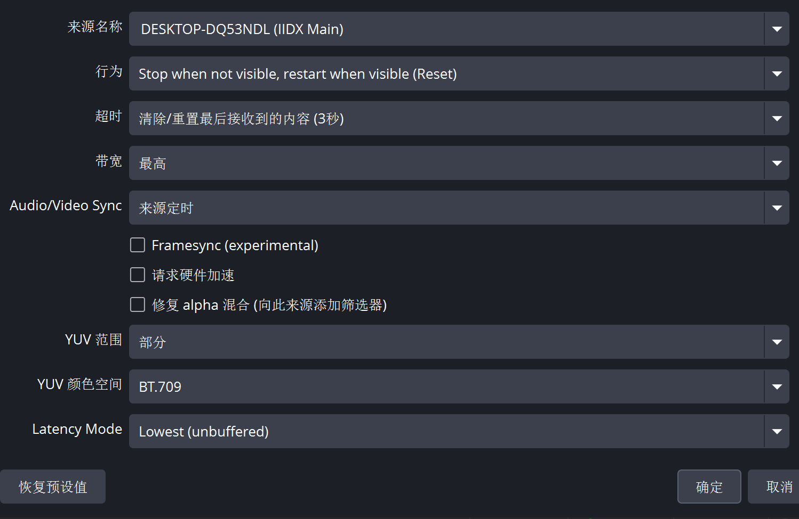
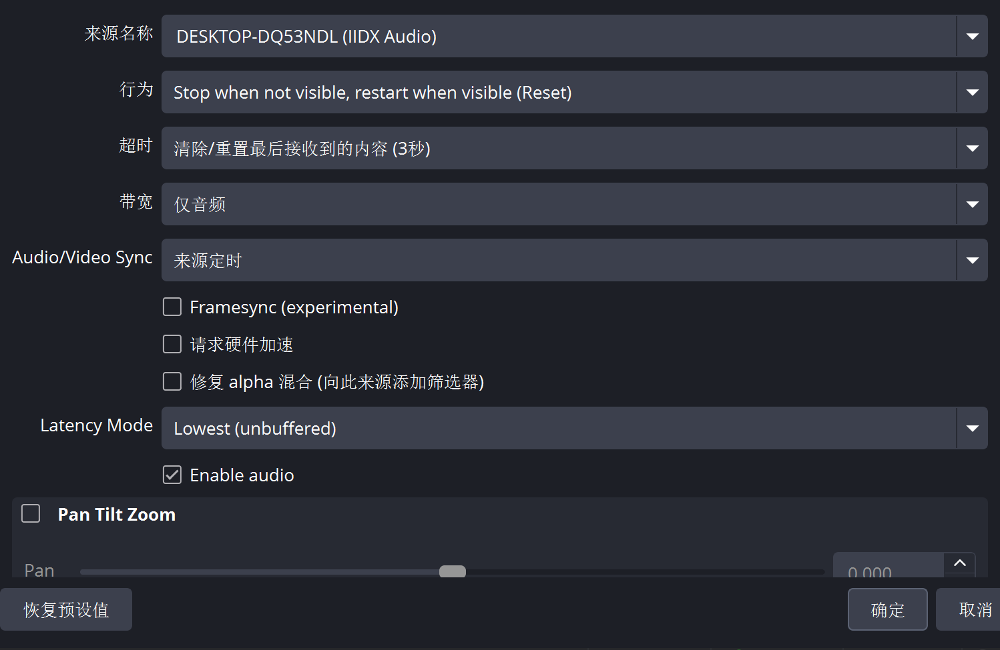

# bemandi

[English](README.md) | [简体中文](README.zh-CN.md)

通过 Windows x64 Spice 插件，直接将 IIDX 的游戏画面和原生音频以 NDI 发送到**另一台电脑**上的 OBS Studio。

## 功能

- 直接采集 D3D9/D3D9Ex 游戏画面，已在 IIDX34 上测试 1920×1080 / 120 Hz 输出。
- 采集 44.1 kHz 原生立体声音频，已在使用 ASIO 输出的机台上测试。
- 分别提供 `IIDX Main` 视频源和 `IIDX Audio` 音频源，使用同一时钟生成同步的发送端时间码。
- GPU UYVY 色彩转换、有容量限制的采集队列，以及独立工作线程传输。

## 安装 NDI 和 OBS

使用同一有线网络中的两台电脑：

- **IIDX 游戏电脑：**安装 **NDI 6 Runtime** 和 bemandi.dll。这台电脑不需要运行 OBS。
- **另一台电脑（直播电脑）：**安装 **OBS Studio**、[DistroAV NDI 插件](https://github.com/DistroAV/DistroAV)及其要求的 **NDI Runtime**。

OBS/DistroAV 的安装步骤见 DistroAV 文档中的 [Installation → Windows](https://github.com/DistroAV/DistroAV/wiki/1.-Installation#windows)，其他系统请查看对应章节。安装前请确认[当前 OBS 和 NDI 的版本要求](https://github.com/DistroAV/DistroAV#-requirements)。

NDI SDK/运行库的安装说明和下载链接见 [Required Components — NDI Runtime](https://github.com/DistroAV/DistroAV/wiki/1.-Installation#required-components---ndi-runtime)。在 Windows 上运行 bemandi 只需要独立运行库，无需安装完整的开发 SDK。IIDX 游戏电脑和直播电脑都需要安装运行库。

Windows 安装命令：

```powershell
# 在 IIDX 游戏电脑上运行：安装 NDI 运行库。
winget install --exact --id NDI.NDIRuntime

# 在另一台电脑上运行：安装 DistroAV、OBS 及其依赖。
winget install --exact --id DistroAV.DistroAV
```

如果使用手动安装包，请在直播电脑上安装 OBS、DistroAV 和 NDI 运行库，然后重启 OBS，再添加来源。

## 快速开始

1. 将 `bemandi.dll` 和 `bemandi.ini` 复制到游戏安装目录下的 `modules` 文件夹。
2. 在现有 Spice 启动命令中添加 `-k bemandi.dll`，保留其他参数。
3. 启动游戏。如果找不到来源，请检查插件旁的 `bemandi.log`。
4. **在另一台电脑（直播电脑）上**打开 OBS，添加两个 DistroAV NDI 来源：`IIDX Main` 用于画面，`IIDX Audio` 用于声音。来源名称中还会包含游戏电脑的主机名。
5. 按下文配置两个来源，并禁用 OBS 中重复采集游戏声音的其他来源。

## OBS 来源设置

以下设置均在**直播电脑**上的 OBS 中操作，直播电脑与 IIDX 游戏电脑是两台不同的电脑。

游戏端已经发送带有同步时间码的视频和音频：bemandi 的两个来源使用同一时钟。请将两个 OBS 来源的音视频同步方式都设为**来源定时（Source Timing / NDI Source Timecode）**，以使用发送端的时间信息。接收端设置和缓冲内容仍可能影响实际播放时的音画同步。

以下是已在图示 IIDX 环境中确认可用的设置。不同 DistroAV 版本或语言下的选项名称可能有所不同。

| 设置 | `IIDX Main`（视频） | `IIDX Audio`（音频） |
| --- | --- | --- |
| 行为 | 不可见时停止，可见时重新启动（重置）：Stop when not visible, restart when visible (Reset) | 相同 |
| 超时 | 清除/重置最后接收到的内容（3 秒） | 相同 |
| 带宽 | 最高 | 仅音频 |
| Audio/Video Sync | 来源定时 / NDI Source Timecode | 相同 |
| Framesync (experimental) | 关闭 | 关闭 |
| 请求硬件加速 | 关闭 | 关闭 |
| 修复 alpha 混合 | 关闭 | 关闭 |
| Latency Mode | Lowest (unbuffered)，最低延迟（无缓冲） | 相同 |
| YUV 范围 / 色彩空间 | 部分（有限范围）/ BT.709 | 不适用 |
| Enable audio | 不适用：此来源仅包含视频 | 开启 |

### 视频：IIDX Main

选择主视频源，将带宽设为**最高**。默认 UYVY 输出使用**部分 / BT.709** 色彩设置。



### 音频：IIDX Audio

选择音频源，将带宽设为**仅音频**，并勾选 **Enable audio**。定时、行为、超时和延迟设置应与视频源一致。



### 音画不同步时

请先对照上表检查两个 OBS 来源的设置。在一次实际使用中，OBS NDI 来源使用 **Pause（暂停）**行为时，重启游戏后出现了明显的音画延迟。怀疑是接收端保留或积累了帧；应用上述设置，并**完全退出后重新启动 OBS Studio 以清空缓冲**，解决了该问题。

请使用图示的 **Reset（重置）**行为。如果重启游戏后仍有明显偏移，请重启 OBS。手动添加同步偏移之前，先录制一小段本地视频检查效果；手动偏移可能只是掩盖旧缓冲造成的问题。如果问题持续，请检查 OBS 日志和 `bemandi.log` 中的缓冲、采集丢帧或时间不连续记录。

## 配置

编辑插件旁的 `bemandi.ini`，然后重启游戏以应用更改。

- `[video]`：`format=uyvy`（默认）或 `bgra`、`fps=120`、`width=1920`、`height=1080`、`swapchain=0`、`source_name=IIDX Main`。
- `[audio]`：`enabled=1`、`source_name=IIDX Audio`。
- `[video]` 下的 `ndi_runtime` 可指定 `Processing.NDI.Lib.x64.dll` 的绝对路径；留空时，插件会搜索已安装的 NDI 6 运行库位置。

宽度和高度用于选择匹配的游戏后缓冲区，不会缩放画面。一次仅支持一个视频交换链。音频来自游戏原生立体声录音混音，其音量可能与机台扬声器不同。不支持同时采集主屏和副屏、HDR 或 D3D11/12。

## 构建与验证

需要 Visual Studio 2022 C++ 工具、Windows SDK、Git 和 CMake 3.25+（bootstrap 脚本可在本地安装 CMake）。

```powershell
powershell -NoProfile -ExecutionPolicy Bypass -File scripts/bootstrap.ps1
powershell -NoProfile -ExecutionPolicy Bypass -File scripts/build.ps1
powershell -NoProfile -ExecutionPolicy Bypass -File scripts/package.ps1
```

构建会生成 `build/bemandi.dll` 并运行单元测试。安装 NDI 运行库后，可运行 `scripts/test-video.ps1` 和 `scripts/test-audio.ps1` 进行合成信号集成测试。测试范围见[音频验证记录](docs/audio-refactor-validation.txt)；这些测试不能代替接收端的音画同步验证。推送版本标签后，GitHub Actions 会构建并发布 ZIP 格式的发行包。

## 许可证

项目代码采用 [MIT 许可证](LICENSE)。另请参阅[第三方声明](THIRD_PARTY_NOTICES.txt)。NDI 是 Vizrt NDI AB 的注册商标，其专有运行库作为独立依赖安装。[NDI SDK 和运行库信息](https://ndi.video/for-developers/ndi-sdk/)。
